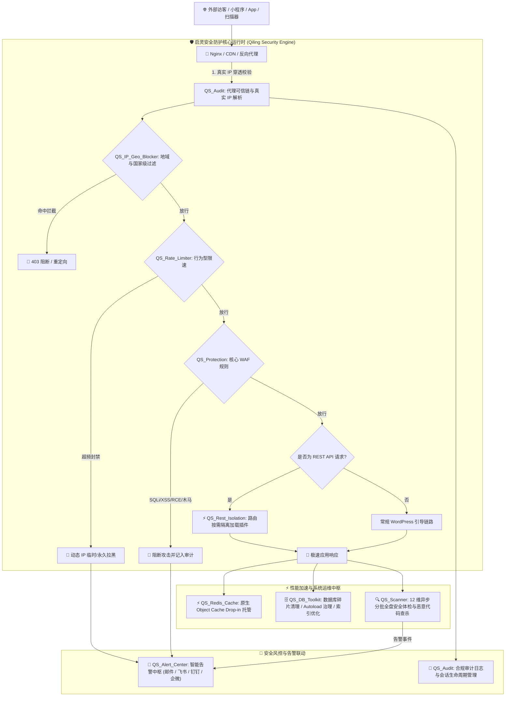

# 启灵安全防护 (Qiling Security)

<p align="center">
  
  
  
  
  
  
</p>

<p align="center">
  <strong>专为生产级 WordPress 站点与高性能小程序/前后端分离应用量身打造的下一代深度安全防御与性能加速套件。</strong>
</p>

---

## 📖 目录

- [💡 为什么选择启灵安全防护？](#-为什么选择启灵安全防护)
- [✨ 核心功能矩阵](#-核心功能矩阵)
  - [1. 🛡️ 12 维全盘安全体检与恶意代码查杀](#1-️-12-维全盘安全体检与恶意代码查杀)
  - [2. 🧱 应用级主动防火墙 (WAF) 与行为限速](#2--应用级主动防火墙-waf-与行为限速)
  - [3. 🌍 IP 穿透识别、风险画像与地域封控](#3--ip-穿透识别风险画像与地域封控)
  - [4. ⚡ 原生 Redis 对象缓存管家 (Object Cache)](#4--原生-redis-对象缓存管家-object-cache)
  - [5. 🔌 独家黑科技：REST API 路由按需隔离加载](#5--独家黑科技rest-api-路由按需隔离加载)
  - [6. 🗄️ 数据库深度治理与安全工具箱 (DB Toolkit)](#6-️-数据库深度治理与安全工具箱-db-toolkit)
  - [7. 🔔 全渠道安全告警中心 (Alert Center)](#7--全渠道安全告警中心-alert-center)
  - [8. 👥 用户活跃会话与核心操作审计](#8--用户活跃会话与核心操作审计)
  - [9. 🇨🇳 中国本土化纯净加速与系统去指纹](#9--中国本土化纯净加速与系统去指纹)
- [🏗️ 系统架构图](#️-系统架构图)
- [⚙️ 运行环境要求](#️-运行环境要求)
- [🚀 快速开始与安装部署](#-快速开始与安装部署)
- [🎯 生产加固最佳实践](#-生产加固最佳实践)
  - [反代/CDN 真实 IP 识别配置](#反代cdn-真实-ip-识别配置)
  - [Nginx 生产级安全防护配置片段](#nginx-生产级安全防护配置片段)
- [📂 目录结构说明](#-目录结构说明)
- [❓ 常见问题 (FAQ)](#-常见问题-faq)
- [🤝 贡献与反馈](#-贡献与反馈)
- [📄 开源协议](#-开源协议)

---

## 💡 为什么选择启灵安全防护？

市面上的 WordPress 安全插件大多存在以下痛点：
1. **体积庞大且臃肿**：引入大量不必要的外部 JS/CSS 依赖，拖慢前台与后台加载速度；
2. **海外网络依赖严重**：频繁发起对海外 API 的连通性校验，导致国内服务器后台频繁转圈、卡死甚至 504 Gateway Timeout；
3. **安全与性能割裂**：开着笨重的安全防火墙，却对 API 接口高频调用、数据库碎片、Redis 缓存一筹莫展；
4. **小程序与前后端分离场景水土不服**：每次 REST API 请求都会无差别加载全站数十个插件，消耗数十倍内存与 CPU。

**启灵安全防护 (Qiling Security)** 彻底颠覆了这种传统模式。它不仅是一个具备 **12 维深度安全巡检** 与 **智能 WAF** 的防御中心，更是融入了 **REST API 路由级插件隔离按需加载**、**原生高性能 Redis Drop-in 托管**、**数据库碎片安全清理与索引加速** 等核心黑科技的综合性站长中枢。

---

## ✨ 核心功能矩阵

### 1. 🛡️ 12 维全盘安全体检与恶意代码查杀
采用分批异步流式扫描引擎，百万级文件大站点扫描不打崩内存、不超时熔断：

| 检查维度 | 检测范围与说明 |
| :--- | :--- |
| **全盘敏感文件检测** | 侦测 `.env`、`.git`、`.svn`、`.sql`、`wp-config.php.bak`、数据库备份等敏感文件外泄 |
| **Uploads 目录后门查杀** | 深度识别图片马、伪装脚本、多重后缀 (`.php.jpg`)、无合法 MIME 声明的恶意代码 |
| **主题/插件代码审计** | 静态 AST 与正则语法匹配高危函数：`eval`, `system`, `shell_exec`, `passthru`, `file_put_contents` 等 |
| **已知漏洞情报库比对** | 自动比对插件与主题的 CVE 漏洞情报库，防范已知组件 N-Day 风险 |
| **异常管理员与权限审计** | 审计特权管理员账号、侦测高危弱口令账户 (`admin`, `root` 等) 与未授权提权提权漏洞 |
| **持久化驻留点审计** | 扫描异常 WP-Cron 定时任务、MU-Plugins (Must-Use 插件)、Drop-in 文件的劫持与隐藏挂马 |
| **数据库风险与 Option 审计** | 检测 `wp_options` 表内注入的恶意脚本代码、超大 Autoload Option 与异常自加载键 |
| **核心目录及文件权限** | 扫描核心文件权限、目录索引漏洞 (Directory Indexing) 与调试日志泄露 (`debug.log`) |
| **公网敏感 API 暴露探测** | 侦测 `/wp-json/wp/v2/users` 用户枚举风险、`xmlrpc.php` 爆破入口与站点地图暴露 |
| **全站暗链与前端防挂马** | 深度排查黑帽 SEO 暗链、隐藏 iframe (`display:none` / `position:absolute`)、恶意重定向 |
| **文件完整性基线比对 (Baseline)** | 建立全站核心文件的 SHA256 指纹基线，实时比对文件篡改、新增与异常变更 |
| **官方核心文件完整性校验** | 直连 WordPress 官方校验和 (Checksums) 接口，一键甄别受污染的核心系统文件 |

---

### 2. 🧱 应用级主动防火墙 (WAF) 与行为限速
- **智能规则拦截**：深度过滤 GET / POST / COOKIE 中的 SQL 注入、XSS、目录遍历 (`../`)、代码注入及非法序列化数据。
- **高置信度封禁联动**：触发致命威胁规则自动执行 IP 封禁（默认临时拉黑 24 小时）。
- **行为型频率限制 (Rate Limiting)**：
  - 基于滑动时间窗口（Sliding Window）算法，实时统计单位时间内的请求突增与频次。
  - 支持针对特定接口（如登录端点、高频 API、核心资源）配置独立限速策略。
  - 支持「仅观察记录」与「阈值自动拦截封禁」双运行模式。
- **登录入口隐藏与加固**：
  - 支持设置隐藏的后台登录密钥别名（如 `wp-login.php?mysecret=1`）。
  - 未携带密钥的访客直接响应标准 **404 Not Found**，拦截 99.9% 扫描器盲扫。
  - 登录错误信息脱敏：模糊化「用户名不存在」与「密码错误」，防御暴力枚举。
- **用户枚举彻底封死**：
  - 拦截 REST API `/wp/v2/users` 游客访问权限。
  - 拦截 `/?author=1` 恶意跳转探测。
  - 拦截 XML-RPC (`xmlrpc.php`) 及其 Pingback 反弹攻击面。
- **安全标头自动防护**：自动注入 `X-Content-Type-Options: nosniff`、`X-Frame-Options: SAMEORIGIN`、`X-XSS-Protection` 等安全 Header。

---

### 3. 🌍 IP 穿透识别、风险画像与地域封控
- **精准真实 IP 穿透引擎**：
  - 原生内置各大主流 CDN / WAF / 反向代理网络模板：**Cloudflare**、**阿里云 CDN/DCDN**、**腾讯云 CDN / EdgeOne**、**华为云 CDN/WAF**、**百度智能云**、**七牛云**、**又拍云**、**同机 Nginx/宝塔反代**。
  - 强制校验可信代理网段（Trusted Proxies），杜绝恶意伪造 `X-Forwarded-For` 欺骗防火墙。
- **登录 IP 风险画像 (IP Risk Profile)**：
  - 针对用户登录成功与失败事件进行精准溯源。
  - 聚合多方威胁情报源（ipdata, ipinfo, ip-api），智能识别数据中心代理 (Datacenter Proxy)、VPN、Tor 节点。
  - 异步队列刷新与外部 Cron 调度，对前台和管理后台交互 **零等待、零卡顿**。
- **国家与地区级精准访问管控 (GeoIP Blocker)**：
  - 灵活设置允许/禁止访问的国家或区域名单（如拦截特定国家境外恶意扫描）。
  - 支持命中后直接响应 **403 Forbidden** 或无损 302 重定向至指定警示页面。
  - 内置高性能 IP 本地二级缓存，毫秒级比对。
- **本地化手机号归属地解析 (Phone Location)**：
  - 自带离线二进制号段数据库 `phone/qiphone.dat`，离线本地毫秒级解析手机号归属地与运营商，无需依赖第三方不稳定接口。

---

### 4. ⚡ 原生 Redis 对象缓存管家 (Object Cache)
- **开箱即用的原生 Drop-in 托管**：
  - 一键部署并托管 `wp-content/object-cache.php`，告别第三方臃肿扩展冲突。
  - 完善的 Redis 连接状态探针、延迟测试与集群状态健康感知。
- **多站点与多数据库安全隔离**：
  - 支持自定义数据库编号 (DB Index: 0-15) 与自定义键前缀，同台 Redis 承载多站点数据绝不混淆。
- **精细化分组与定向清理**：
  - 采用独创的索引映射管理，刷新特定页面/文章缓存时定向精准淘汰，彻底避免全局 `FLUSHDB` 造成的 Redis 击穿与 CPU 抖动。
  - 内置可视化 Redis 大盘：实时监测命中率 (Hit Rate)、键总数、内存占用峰值与状态图表。

---

### 5. 🔌 独家黑科技：REST API 路由按需隔离加载
> 💡 **针对小程序 / 移动端 App / 微信生态 / Vue & React 前后端分离站点的颠覆性加速体验！**

- **问题背景**：原生 WordPress 在收到任何 REST API 请求时，都会无条件加载 `active_plugins` 中的所有插件。如果站点安装了 40 个插件，哪怕只是小程序请求一个分类列表，也会将 40 个插件全部加载执行，导致内存暴增、响应耗时剧增！
- **隔离技术原理**：
  - 插件自动在 `wp-content/mu-plugins/` 中置入轻量级拦截器。
  - 在 WordPress 加载所有插件的最前沿阶段，智能嗅探当前 REST 路由。
  - 仅加载该路由所必需的插件，其余无关插件从内存中暂时排除！
- **核心收益**：
  - REST API 接口吞吐量 (QPS) **提升 200% ~ 500%**；
  - 接口响应延迟 (TTFB) **降低 50% ~ 80%**；
  - 显著缩小 API 攻击面，即便未加载插件存在高危漏洞，恶意请求也无法触发其代码！

---

### 6. 🗄️ 数据库深度治理与安全工具箱 (DB Toolkit)
- **数据库全局健康大盘**：直观展示表存储引擎 (InnoDB/MyISAM)、数据大小、索引大小、碎片空间 (Overhead)。
- **Autoload 治理专家**：
  - 深度扫描 `wp_options` 表中所有被标记为 `autoload = 'yes'` 的配置项。
  - 标记超出警戒大小（默认 > 100KB）的高危超大选项，支持一键切换自加载状态。
- **安全垃圾数据清理**：
  - 文章修订版本（可保留最近 N 个版本）、自动草稿、回收站文章。
  - 垃圾评论、未审核评论。
  - 过期 Transient 瞬态数据。
  - 孤立元数据：无主 `postmeta`、`commentmeta`、`termmeta` 及关联关系。
- **安全序列化批量查找与替换 (Search & Replace)**：
  - 专为域名迁移、全站换域名或敏感关键字清洗研发。
  - **完美支持 PHP 递归序列化数据解构与重构**，绝不破坏复杂主题/插件配置数据！
  - **支持 Dry-Run 演练模式**：在真实写入数据库前先预览命中项与变动统计，万无一失。
- **核心表索引智能加固**：
  - 一键为 `wp_posts`, `wp_postmeta`, `wp_comments` 添加生产级联合优化索引，告别慢查询导致的数据库 CPU 100%。

---

### 7. 🔔 全渠道安全告警中心 (Alert Center)
支持在站点发生关键安全事件时，秒级推送到运维团队即时通讯群组：
- **告警触发事件源**：
  - 暴力破解触发 IP 自动封禁；
  - WAF 拦截到高置信度注入/跨站攻击；
  - 恶意代码/Webshell 查杀命中；
  - 管理员账号/权限发生变动；
  - 核心文件或基线文件被篡改；
  - 关键系统配置被非法修改。
- **推送通道**：
  - 📧 **邮件即时推送**：支持多收件人与自定义邮件主题前缀。
  - 🤖 **Webhook 即时通讯推送**：无缝联动启灵消息通知组件 (`qilinghook`)，支持 **飞书**、**钉钉**、**企业微信** 等群机器人。
- **防风暴冷却保护 (Cooldown)**：内置事件防重与智能冷却算法，杜绝因高频扫描攻击导致告警轰炸。

---

### 8. 👥 用户活跃会话与核心操作审计
- **全站用户会话监控**：
  - 查看当前所有在线用户的会话列表、登录时间、来源 IP、地理位置与客户端 User-Agent。
  - 支持设置最大并发会话数，多端登录强制踢下线。
  - 支持一键终止指定异地可疑会话或踢除其他所有在线设备。
- **合规操作审计日志 (Audit Log)**：
  - 详细记录关键操作：用户登录/登出、插件启用/停用、关键 Option 修改、文章删除、WordPress 核心升级等。
  - 自动保留真实访客 IP、操作者 ID、执行状态与时间戳，审计证据链完整合规。

---

### 9. 🇨🇳 中国本土化纯净加速与系统去指纹
- **屏蔽官方慢速连接**：阻断对 `wordpress.org` 的海外 HTTP 请求，彻底根治国内服务器后台卡顿与超时问题。
- **移除冗余组件**：清理 Emoji 脚本与样式、移除 RSD/WLW 接口、禁用 Embeds 嵌入与 Openverse 远程素材库。
- **系统去指纹**：移除 WordPress 版本号、发生器标签、清理前端各类特征代码，最大化降低被黑客针对性指纹扫描的概率。

---

## 🏗️ 系统架构图



---

## ⚙️ 运行环境要求

| 环境组件 | 最低要求 | 推荐配置 | 说明 |
| :--- | :--- | :--- | :--- |
| **WordPress** | `>= 5.8` | `6.0+` | 完美兼容经典编辑器与 Gutenberg 区块编辑器 |
| **PHP 版本** | `>= 7.4` | `8.0` / `8.1` / `8.2` / `8.3` | 需启用 `curl`、`mbstring`、`json`、`pcre` 扩展 |
| **数据库** | MySQL `>= 5.7` | MySQL `8.0+` / MariaDB `10.5+` | 支持 InnoDB 存储引擎 |
| **Web 服务器** | Nginx / Apache / OpenLiteSpeed | **Nginx 1.20+** | 推荐配合 Nginx 实现多层纵深防御 |
| **Redis** *(可选)* | `>= 5.0` | **Redis 6.2+ / 7.0+** | 用于高性能对象缓存加速与限速计数器 |

---

## 🚀 快速开始与安装部署

### 方式一：GitHub Release 压缩包安装 (推荐)
1. 前往本仓库的 [Releases 页面](https://github.com/summer-qiling/qilingsecurity/releases) 下载最新版本的 `qilingsecurity.zip`。
2. 登录 WordPress 管理后台，进入 **插件 -> 安装插件 -> 上传插件**。
3. 选择下载的 zip 文件并点击 **现在安装**。
4. 安装完成后点击 **启用插件**。
5. 在左侧菜单栏点击 **「启灵安全」** 即可进入控制中心。

### 方式二：Git 仓库克隆安装
在服务器的 WordPress 插件目录直接克隆：

```bash
cd /www/wwwroot/your-site.com/wp-content/plugins/
git clone https://github.com/summer-qiling/qilingsecurity.git qilingsecurity
chown -R www:www qilingsecurity
```
进入 WordPress 后台插件管理页面激活即可。

---

## 🎯 生产加固最佳实践

### 反代/CDN 真实 IP 识别配置
如果您的站点前置了 CDN 或反向代理，请务必在 **「启灵安全防护 -> 设置 -> 代理与真实 IP」** 中选择对应的代理服务商预设：
- **Cloudflare**：自动优先匹配 `CF-Connecting-IP` 请求头；
- **阿里云 CDN/DCDN**：自动优先匹配 `Ali-Cdn-Real-Ip` 请求头；
- **腾讯云 CDN / EdgeOne**：自动匹配 `X-Forwarded-For` 与 `EO-Connecting-IP`；
- **自建 Nginx 反代 / 宝塔面板**：匹配 `X-Real-IP` 或信任 `127.0.0.1` 回源头。

> ⚠️ **重要安全提示**：请在「可信代理 IP 网段」中填写反代节点的出口 IP / CIDR 网段，避免任意外部客户端伪造来源头实施 IP 欺骗！

---

### Nginx 生产级安全防护配置片段
在 Web 服务器端与启灵安全防护形成前后呼应，能阻挡 95% 以上的无脑扫描流量。请将以下规则合并至您的站点 Nginx 配置中：

```nginx
# 1. 彻底禁止访问敏感代码仓库、环境文件与备份文件
location ~* /\.(git|svn|hg|env|gitattributes|gitignore) {
    deny all;
    return 404;
}

# 2. 禁止直接访问 uploads 上传目录下的可执行脚本 (防止上传图片马执行)
location ~* ^/wp-content/uploads/.*\.php$ {
    deny all;
    return 404;
}

# 3. 拦截敏感文件读取
location ~* \.(sql|bak|old|swp|dist|md5|sha256)$ {
    deny all;
    return 404;
}

# 4. 彻底禁用 xmlrpc.php 接口（彻底杜绝 Pingback 放大 DDoS 攻击）
location = /xmlrpc.php {
    deny all;
    return 404;
}

# 5. 限制对 wp-config.php 的直接访问
location ~* wp-config\.php {
    deny all;
    return 404;
}
```

---

## 📂 目录结构说明

```
qilingsecurity/
├── assets/                          # 后台 UI 资源文件
│   ├── css/
│   │   ├── admin.css                # 安全中心后台样式
│   │   └── redis-ui.css             # Redis 监控大盘样式
│   └── js/
│       ├── admin.js                 # 异步体检与实时数据交互
│       └── redis-ui.js              # Redis 监控交互脚本
├── dropins/
│   └── object-cache.php.stub        # Redis 原生对象缓存模板
├── includes/                        # 核心逻辑类库
│   ├── class-qs-admin.php           # 后台主菜单与各功能选项卡交互
│   ├── class-qs-ajax.php            # 异步安全体检/清理/扫描 AJAX 处理
│   ├── class-qs-alert-center.php    # 全渠道安全告警中枢 (邮件/飞书/钉钉)
│   ├── class-qs-audit.php           # 真实 IP 穿透与管理操作审计
│   ├── class-qs-db.php              # 数据表创建、维护与基础数据持久化
│   ├── class-qs-db-toolkit.php      # 数据库分析大盘、垃圾清理、索引加固
│   ├── class-qs-health-check.php    # 插件自检与运行环境诊断
│   ├── class-qs-ip-geo-blocker.php  # 国家/区域 GeoIP 拦截器
│   ├── class-qs-ip-risk-profile.php # 登录 IP 多源威胁画像
│   ├── class-qs-localization-mode.php# 中国本土化去指纹与海外断流优化
│   ├── class-qs-phone-location.php  # 本地号段库离线手机归属地解析
│   ├── class-qs-protection-settings.php# 全量安全规则与加固配置字典
│   ├── class-qs-protection.php      # 核心主动防御、WAF、登录门禁
│   ├── class-qs-rate-limiter.php    # 行为型限速与频率熔断器
│   ├── class-qs-redis-cache.php     # Redis 缓存连接管理与状态大盘
│   ├── class-qs-rest-isolation.php  # REST API 路由级插件隔离加载黑科技
│   ├── class-qs-rules.php           # 规则包管理、签名校验与回滚
│   └── class-qs-session-manager.php # 活跃会话追踪与并发管控
├── languages/                       # 多语言国际化文件
├── phone/
│   └── qiphone.dat                  # 本地离线高精度手机号段二进制库
├── qilingsecurity.php               # 插件主入口文件
└── uninstall.php                    # 插件卸载数据自动清理逻辑
```

---

## ❓ 常见问题 (FAQ)

<details>
<summary><strong>Q: 开启「全盘安全体检」会不会导致服务器 CPU 跑满或请求超时？</strong></summary>

> **A**: 不会。启灵安全防护采用了创新的 **分步分片流式扫描架构**（Chunked Scan Runner），每个扫描批次均内置了严格的单批文件数限制与单次时间预算（Time Budget），并通过前端异步轮询控制步进，即使站点有几十万张附件与大型代码库，也能平稳运行，绝不卡死 PHP-FPM。
</details>

<details>
<summary><strong>Q: 启灵安全防护自带的 Redis 缓存和市场上的第三方 Redis 插件冲突吗？</strong></summary>

> **A**: 启灵安全防护内置了独立的 Redis 对象缓存管家。若您先前启用了其他 Redis 插件（例如 Redis Object Cache 等），建议先在旧插件中停用并删除其 `wp-content/object-cache.php`，然后直接在启灵安全防护中一键开启。启灵专属 Drop-in 针对高并发与定向清理进行了深度优化，性能更佳且无广告。
</details>

<details>
<summary><strong>Q: 什么是「REST API 路由按需隔离」？对我的已有插件有风险吗？</strong></summary>

> **A**: 默认情况下该功能处于「监控模式（Observe）」，会记录每次 REST API 命中的路由与加载的插件。当您切换到「隔离模式」时，非关联插件在 API 请求中将不会被载入内存。启灵支持配置「核心常驻插件列表」，您可以将支付、用户验证等基础插件加入常驻，兼顾极致性能与百分百兼容性。
</details>

<details>
<summary><strong>Q: 卸载插件后会在数据库留下垃圾残留吗？</strong></summary>

> **A**: 启灵安全防护严格遵守 WordPress 规范。您可以在 **「设置 -> 数据生命周期」** 中勾选 **「卸载时清理所有数据」**。开启后，在 WordPress 后台点击删除插件时，将自动彻底抹除所有专用数据表 (`qilingsecurity_*`)、配置选项及 MU-Plugins 软链接，真正做到 **零脏数据残留**。
</details>

---

## 🤝 贡献与反馈

欢迎提交 Issue 和 Pull Request！
- 🐛 **提交 Bug 或漏洞反馈**：请提交至 [GitHub Issues](https://github.com/summer-qiling/qilingsecurity/issues)。
- 💡 **功能建议**：欢迎在 Discussions 或 Issues 中发表您的创新想法。
- 🛡️ **负责任的安全漏洞披露**：如果您发现了高危安全缺陷，请优先通过作者官方网站 [https://www.jingxialai.com](https://www.jingxialai.com) 联系我们，以便我们在公开披露前完成修补。

---

## 📄 开源协议

本项目基于 **GPLv2 or later** 协议开源发布。详情请查阅 [LICENSE](https://www.gnu.org/licenses/gpl-2.0.html) 文件。

```
Copyright (C) 2024-2026 summer (https://www.jingxialai.com)
All rights reserved.
```
